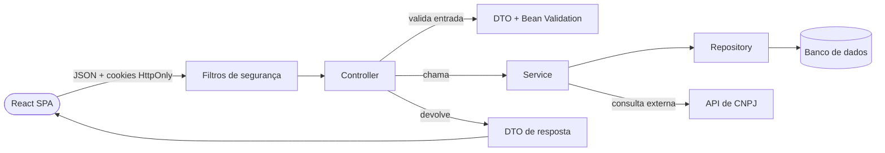

# Arquitetura

O DoaLink é uma aplicação em duas partes: uma API REST em **Spring Boot** (Java) e uma SPA em **React + TypeScript + Tailwind**. No back-end, as regras de negócio ficam concentradas na camada de **service**. Os motivos das decisões estão nos ADRs em `docs/adr/`.

## Visão geral



## Back-end (Spring Boot)

### Estrutura de pacotes

```
com.doalink_api
├── controller      # endpoints REST
├── service         # regras de negócio e orquestração
├── repository      # interfaces Spring Data JPA
├── entities        # entidades JPA (e enums em entities.enums)
├── dtos
│   ├── request     # entrada, com Bean Validation
│   └── response    # saída
├── mapper          # conversões DTO <-> entidade sem regra de negócio
├── security        # JWT, filtro, UserDetails, cookies, SecurityConfig
├── exception       # exceções de domínio e ApiExceptionHandler
└── config          # beans e configurações gerais
```

### Controller (`controller/`)

- Recebe a requisição, aciona a validação do DTO (`@Valid`), chama **um** método de service e devolve o DTO de resposta com o status HTTP correto.
- Não contém regra de negócio nem acessa repository ou entidades diretamente.
- Define a anotação de rota, mas o acesso por perfil (RBAC) é declarado na `SecurityConfig` (ou `@PreAuthorize`), nunca com `if` dentro do método.
- Cookies de sessão são escritos aqui, por meio do `CookieService`, porque dependem de `HttpServletResponse`.
- **Segregação de Contratos e OpenAPI (ADR 0007):** Cada controller possui uma interface de contrato (ex.: `IAuthController`, `IOfertaDoacaoController`) que concentra as anotações do OpenAPI 3 (`@Tag`, `@Operation`, `@ApiResponses`, `@Parameter`), mapeamentos de rotas (`@RequestMapping`, `@PostMapping`, etc.) e validações. A classe concreta apenas implementa a interface com `@RestController` e `@Override`, garantindo legibilidade e ausência de ruído declarativo no código executável.

### DTOs (`dtos/`)

- **Request:** `record` com Bean Validation (`@NotBlank`, `@Email`, `@CPF`, `@CNPJ`, `@Size`, `@Valid`). Validam o **formato** da entrada.
- Regras que cruzam campos do próprio DTO (ex.: CPF ou CNPJ, apenas um) usam `@AssertTrue` em método do record com `@JsonIgnore`. Métodos auxiliares do DTO não usam prefixo `get`/`is` para não virarem propriedades JSON.
- **Response:** `record` com o mínimo necessário. Nunca expõe senha, hash ou documento completo.
- Entidades JPA nunca saem pela API.

### Service (`service/`)

- Toda regra de negócio fica aqui: unicidade de e-mail e documento, normalização, hash de senha, consulta de CNPJ, geração de tokens, rotação de refresh token.
- Define a fronteira transacional (`@Transactional`). Chamadas de rede externas (consulta de CNPJ) não devem manter uma transação aberta.
- Não recebe `HttpServletRequest`/`HttpServletResponse`. Falhas são comunicadas por exceções de domínio.
- O `AuthService` concentra cadastro e login. Passos reaproveitados (validar unicidade, normalizar, preencher dados comuns) são métodos privados curtos e separados.
- Operações de autenticação retornam um `AuthResult` (usuário + tokens). O service não escreve cookies: o controller decide o que vai no corpo e o que vai no cookie.

### Repository (`repository/`)

- Interfaces Spring Data JPA. Apenas consultas, sem lógica.
- Com herança `JOINED`, salvar qualquer subclasse pelo `UsuarioRepository` funciona. Crie repository específico (ex.: `ReceptorRepository`) apenas para consultar campos próprios da subclasse.

### Entidades (`entities/`)

- Definem campos, relacionamentos e metadados, sem regra de negócio.
- `Usuario` é abstrata, com `@Inheritance(strategy = JOINED)`. Subclasses: `Doador`, `Transportador` e `Receptor`.
- O perfil é identificado pelo enum `TipoUsuario`, fixado no construtor de cada subclasse (setter `protected`). Não há `@DiscriminatorColumn`.
- Enums sempre com `@Enumerated(EnumType.STRING)`.
- O documento (CPF ou CNPJ) é guardado em um único campo `documento`, **normalizado** (sem pontuação), junto de `tipoPessoa`. A unicidade é garantida por constraint no banco.
- Dados de endereço do Receptor ficam em um `@Embeddable` (`Endereco`).

### Exceções (`exception/`)

- Exceções de domínio estendem `RuntimeException` (ex.: `ConflictException`, `TokenInvalidoException`).
- O `ApiExceptionHandler` (`@RestControllerAdvice`) converte exceções em respostas HTTP padronizadas: 400 (validação), 401, 409 (conflito, inclusive `DataIntegrityViolationException`).
- Respostas de 401/403 geradas pelos filtros de segurança vêm da `SecurityConfig` (`authenticationEntryPoint` e `accessDeniedHandler`), pois o `@RestControllerAdvice` não as captura.

### Segurança (`security/`)

- **Stateless:** `SessionCreationPolicy.STATELESS`; o servidor não usa `HttpSession`.
- **Access token:** JWT curto (15 min), assinado com HMAC256 (biblioteca `com.auth0:java-jwt`), em cookie HttpOnly. Contém `id` (subject), e-mail e role. O `JwtAuthFilter` o valida só pela assinatura, sem consultar o banco.
- **Refresh token:** valor opaco e aleatório, validade de 7 dias, em cookie HttpOnly com `path=/auth`. Somente o **hash SHA-256** é guardado na tabela `refresh_tokens`.
- **Rotação:** cada `/auth/refresh` revoga o token usado e emite um novo par. Reapresentar um token já revogado revoga todos os tokens do usuário.
- **Cookies:** `HttpOnly`, `Secure` (configurável por ambiente) e `SameSite=Strict`. Com `SameSite=Strict` e front/API no mesmo site, o CSRF fica desabilitado; se em produção o front ficar em outro site, a decisão deve ser revista em novo ADR.
- **RBAC:** a role vem de `TipoUsuario` (`ROLE_DOADOR`, `ROLE_TRANSPORTADOR`, `ROLE_RECEPTOR`) e é aplicada na `SecurityConfig`.
- **CORS:** origens explícitas (nunca `*`) e `allowCredentials(true)`.
- **Senhas:** `BCryptPasswordEncoder`; limite de 72 bytes do BCrypt reflete no `@Size(max = ...)` do DTO.
- **`UserDetails`:** `UsuarioDetails` envolve a entidade e é usado apenas no login. O principal colocado no contexto pelo filtro é um record leve (`UsuarioAutenticado`).

### Rotas

- Rotas públicas de autenticação ficam sob `/auth`: `/auth/login`, `/auth/refresh`, `/auth/logout` e um cadastro por perfil (`/auth/doadores/cadastro`, `/auth/transportadores/cadastro`, `/auth/receptores/cadastro`).
- O perfil é definido pela **rota**, não por um campo do corpo, então não há como um cliente se cadastrar em um perfil não previsto.
- Rotas públicas são listadas explicitamente na `SecurityConfig`, sem curinga `/auth/**`.
- Todas as demais rotas exigem autenticação; rotas de domínio exigem a role do perfil.

### Banco de dados

- Constraints são a garantia final de integridade: `UNIQUE` em e-mail e documento, `CHECK` coerente entre `tipo_pessoa` e tamanho do `documento`.
- Alterações de esquema por migration versionada (Flyway ou Liquibase), não por `ddl-auto` em produção.
- Verificações no service (`existsBy...`) existem para mensagens amigáveis; a corrida entre requisições simultâneas é resolvida pela constraint e tratada como 409.

### Integrações externas

- A consulta de CNPJ fica atrás de uma interface (`ConsultaCnpjService`), com timeout configurado, e roda **somente** para pessoa jurídica e sempre para Receptor.
- A chamada é feita no back-end, nunca no front-end, para não expor chaves, manter o controle de timeout e não confiar em validação do cliente.

## Front-end (React + TypeScript + Tailwind)

### Estrutura

```
src
├── pages           # uma página por rota
├── components      # componentes reutilizáveis (sem chamadas de API)
├── features        # agrupamento por funcionalidade (auth, doacoes, ...)
├── services        # clientes HTTP (uma função por endpoint)
├── hooks           # hooks reutilizáveis (ex.: useAuth)
├── contexts        # estado global necessário (ex.: usuário logado)
├── routes          # definição de rotas e rotas protegidas por perfil
├── types           # tipos e interfaces (espelham os DTOs da API)
└── utils           # funções puras (máscaras, formatadores)
```

### Responsabilidades

- **Pages** compõem componentes e chamam hooks/serviços. **Components** apenas apresentam e recebem dados por props.
- **Services** concentram o acesso à API. Todo `fetch` usa `credentials: 'include'`, porque a sessão vive em cookies HttpOnly. O front **nunca** lê nem guarda tokens (sem `localStorage`).
- **Tipos** em `types/` espelham os DTOs de request e response do back-end.
- **Validação no formulário** serve à experiência do usuário. A validação que vale é a do back-end, e os erros 400/409 devolvidos pela API são exibidos nos campos.
- **Máscaras** (CPF, CNPJ, CEP, telefone) são só de apresentação: o front envia o valor como está ou sem pontuação, e o back-end normaliza.
- **Seleção PF/PJ:** o formulário mostra apenas o campo escolhido (CPF ou CNPJ) e envia somente ele. No cadastro de Receptor só existe CNPJ.
- **Sessão expirada:** ao receber 401, o cliente HTTP chama `POST /auth/refresh` uma única vez e repete a requisição original. Se o refresh falhar, redireciona para o login. Chamadas de refresh simultâneas são serializadas (uma só em andamento).
- **Rotas protegidas** verificam o perfil do usuário logado (obtido na resposta de login/cadastro ou por endpoint de "quem sou eu") e redirecionam quando o perfil não tem acesso. Isso é só experiência: a autorização real é do back-end.
- **Tailwind:** estilização por classes utilitárias; padrões repetidos viram componentes, não classes CSS customizadas.

## Testes

- **Back-end:** JUnit 5 e Mockito para services; `@WebMvcTest`/MockMvc para controllers e segurança; teste de integração com banco real em container para repositories e constraints.
- **Front-end:** Vitest e Testing Library para componentes e hooks.
- Rotas protegidas cobrem visitante (401), perfil errado (403) e perfil correto (sucesso).

## Documentação do projeto

- `docs/prd/`: o que o produto faz (requisitos funcionais, critérios de aceite, decisões pendentes).
- `docs/specs/`: como cada funcionalidade é construída.
- `docs/adr/`: por que as decisões estruturais foram tomadas.

ADRs sugeridos para registrar as decisões já tomadas:

| ADR | Decisão |
|---|---|
| 0001 | Arquitetura em camadas com regras de negócio no service |
| 0002 | Herança JPA `JOINED` com enum `TipoUsuario`, sem discriminator |
| 0003 | Campo único `documento` normalizado + `tipoPessoa` |
| 0004 | Cadastro por perfil em endpoints separados sob `/auth` |
| 0005 | JWT em cookies HttpOnly com refresh token opaco no banco e rotação |
